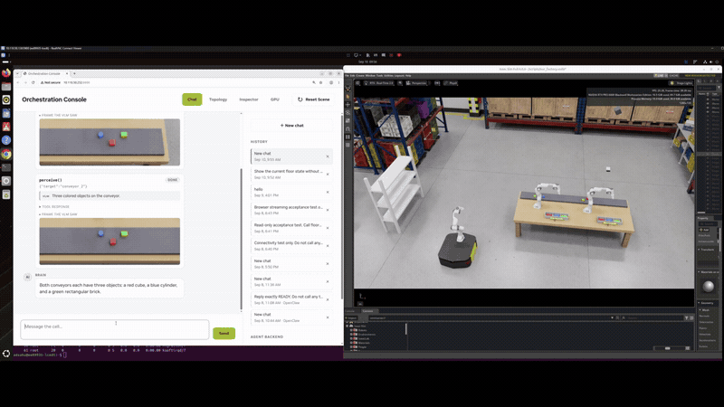
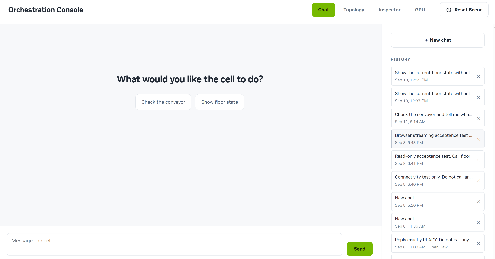

# Policy-Gated Factory Robot Orchestrator Reference

<p align="center">
  <a href="LICENSE"></a>
  
  
  
</p>

A reference application for controlling an Isaac Sim factory cell through
Chat or an agent client. PGFR Spine checks action policy, sends commands over
ROS 2, verifies results, and records mission evidence. Isaac Sim runs on an RTX
workstation; agent services, vision, and GR00T inference run on Jetson AGX Thor.
The orchestration model is accessed through a configured API endpoint.

Use the supplied scene or [adapt it to your own robots and tasks](#adapt-the-reference-to-your-own-scene).
The release includes source, dataset-creation tools, and a GR00T fine-tuning
recipe. You supply your own demonstration dataset and fine-tuned checkpoint.
Start with [dataset creation](reference/policy-gated-factory-robot-orchestrator-reference/groot/groot_n1_7_pgfr_pipeline/docs/DATASET_CREATION.md)
and [training](reference/policy-gated-factory-robot-orchestrator-reference/groot/groot_n1_7_pgfr_pipeline/docs/FINETUNING_RECIPE.md).

Setup uses NVIDIA's official Isaac Sim image with mounted project files and a
native GR00T environment on Thor. Training uses a separate environment. See
[release scope](docs/RELEASE-SCOPE.md) for upstream software and model requirements.

## Reference capabilities

- **Object sorting:** two fixed Franka arms use one user-trained GR00T checkpoint,
  served by a separate process for each arm.
- **Tote delivery:** an AMR uses scripted control to move both totes to the rack.
- **Verification:** the service checks simulator results and camera evidence
  after each action and records them in the mission journal.

The default acceptance workflow runs six serial object placements followed by
two tote transfers. Concurrent arm execution requires a separate opt-in profile.
Physical dispatches are not retried automatically.

## Full demo

Console-driven sorting and tote delivery in Isaac Sim, shown at **3× speed**.
The GIF plays the complete 62-second recording without audio.

[](docs/videos/pgfr-demo-3x.mp4)

[Watch or download the original MP4](docs/videos/pgfr-demo-3x.mp4)
(1280×720, with audio, 20.7 MB).

## Isaac Sim reference cell


Two fixed Franka arms sort objects into totes. A mobile manipulator transports
the totes to the receiving rack. See the [scene guide](docs/ISAAC-SIM-SCENE.md)
for pictures and explanations of each component.

## Dashboard

The Orchestration Console opens in Chat, with topology, inspection, and GPU
views available from the header.



## Architecture

See [Architecture details](docs/ARCHITECTURE.md) for component responsibilities
and the two-host deployment.

| Component | Purpose | Interface |
|---|---|---|
| [PGFR Console](pgfr-console/) | Operator UI and read-only aggregation API | HTTP, port 8600 |
| [PGFR Chat](servers/pgfr-chat/) | Model-driven operator commands | HTTP, port 8620 |
| [PGFR Workflows](servers/pgfr-workflows/) | Workflow authoring, execution, and scheduling API | HTTP, port 8610 |
| [MCP server](servers/policy-gated-factory-robot-orchestrator-reference-mcp/) | Agent-facing floor tools and operating instructions | MCP over stdio |
| [PGFR Spine](pgfr-spine/) | Policy, perception, dispatch, verification, and mission records | HTTP, port 8766 |
| [Isaac Sim cell](reference/policy-gated-factory-robot-orchestrator-reference/isaac-cell/) | Simulated factory equipment, cameras, and ROS 2 endpoints | ROS 2 |
| [GR00T integration](reference/policy-gated-factory-robot-orchestrator-reference/groot/) | Per-arm policy serving, relays, and the simulation-host bridge | Loopback services and ROS 2 |

The Default Chat backend calls PGFR Spine over HTTP. The OpenClaw backend uses
MCP. Both apply the same floor policy and result checks.

## Reference deployment

| Host | Role | Validated configuration |
|---|---|---|
| Jetson control host | PGFR Spine, PGFR Console, Chat, Workflows, perception VLM, and GR00T policy serving | Jetson AGX Thor, aarch64 Ubuntu 24.04, Python 3.12, ROS 2 Jazzy |
| RTX simulation host | Isaac Sim, cameras, robot executors, and the two-host bridge | x86_64 Ubuntu 24.04, NVIDIA RTX GPU, Docker, NVIDIA Container Runtime |
| Operator system | Browser or MCP client | Network access to the control host through SSH by default |

The standalone scripted baseline uses the official Isaac Sim 6.0.1 container
and defaults to headless WebRTC. The learned GR00T deployment remains pinned to
its validated Isaac Sim 6.0.0-dev2 X11 profile. See
[validated deployment targets](docs/SUPPORT.md) for the exact scope and open
qualification items.

> [!IMPORTANT]
> This is a reference implementation, not a certified functional-safety system.
> A fresh two-host installation under the current package names still needs
> end-to-end validation. See [supported targets and test evidence](docs/SUPPORT.md).

## Quick start

Choose a starting point for the supplied reference cell or your own integration:

| Deployment | Hosts | Use case | Instructions |
|---|---:|---|---|
| Scripted Isaac Sim baseline | One RTX workstation | Run and validate the reference cell without Thor or GR00T | Steps below |
| User-trained GR00T deployment | Jetson AGX Thor and an RTX workstation | Create data, train a policy, then run perception and orchestration | [Installation guide](INSTALL.md) |
| Custom Isaac Sim scene | Your adapted setup | Collect your own dataset, fine-tune GR00T, and integrate your scene | [Adapt the reference](#adapt-the-reference-to-your-own-scene) |

### Scripted Isaac Sim baseline

Prerequisites:

- x86_64 Ubuntu 22.04 or 24.04;
- an NVIDIA RTX GPU with at least 16 GiB VRAM;
- Docker Engine and NVIDIA Container Runtime;
- an NVIDIA driver supported by Isaac Sim 6.0.1 (the preflight currently
  requires 595.58.03 or newer); and
- acceptance of the
  [NVIDIA Isaac Sim license](https://docs.isaacsim.omniverse.nvidia.com/6.0.1/common/licenses-isaac-sim.html).

Clone the repository and pull the pinned Isaac Sim image:

```bash
git clone https://github.com/NVIDIA-AI-IOT/Policy-Gated-Factory-Robot-Orchestrator-Reference.git
cd Policy-Gated-Factory-Robot-Orchestrator-Reference

docker pull \
  nvcr.io/nvidia/isaac-sim:6.0.1@sha256:b1c542b2ecc549b3d1ebb78c25664aa3bacba1709e6ad8e0a68e09426d57dedb
```

Prepare, check, and start the cell:

```bash
ops/isaac-sim-workstation.sh --prepare
ops/isaac-sim-workstation.sh --check --accept-eula
ops/isaac-sim-workstation.sh --run --accept-eula
```

A successful launch prints:

```text
PGFR_ISAAC_BASELINE_READY ... marker=PGFR_CELL_UP ... streaming=true
```

Connect with the
[Isaac Sim WebRTC Streaming Client](https://docs.isaacsim.omniverse.nvidia.com/6.0.1/installation/manual_livestream_clients.html).
The default endpoint is local-only. Remote-client and X11 instructions are in
the [RTX workstation runbook](ops/ISAAC-SIM-WORKSTATION.md).

Run the scripted acceptance test from an idle scene:

```bash
docker pull --platform linux/amd64 \
  docker.io/library/ros:jazzy-ros-base-noble@sha256:2589a8fba5257307857890173c069852c2abf913a0be7970f172478baecb09e4
ops/accept-isaac-sim-workstation.sh \
  --container pgfr-isaac-sim-baseline
```

This test resets the scene, validates 15 ROS 2 streams, executes one simulated
pick-and-place action, verifies the result, and resets the scene again. Do not
run it while another simulation task is active.

### Full Jetson and RTX deployment

The full deployment requires:

- the validated Jetson and RTX host configurations;
- a locally trained and exported GR00T checkpoint;
- access to the documented official NVIDIA base models and runtime backbone;
- credentials for the selected NVIDIA or OpenAI-compatible model endpoint; and
- passwordless SSH from the simulation host to the Jetson control host.

Follow [Installation](INSTALL.md) for the dataset, training, and deployment
sequence, then the [two-host guide](docs/REPRODUCIBLE-DEMO.md) for commands.

## Adapt the reference to your own scene

To use your own Isaac Sim scene and dataset:

1. Define the robots, cameras, objects, and tasks in your scene. Collect or
   import demonstrations with synchronized images, robot states, and executed
   actions that match your setup.
2. Adapt the [dataset pipeline](reference/policy-gated-factory-robot-orchestrator-reference/groot/groot_n1_7_pgfr_pipeline/docs/DATASET_CREATION.md#adapt-to-your-own-isaac-sim-scene)
   to your robot and data, then [fine-tune GR00T](reference/policy-gated-factory-robot-orchestrator-reference/groot/groot_n1_7_pgfr_pipeline/docs/FINETUNING_RECIPE.md).
3. Connect your scene through the [ROS 2 contract](docs/floor-ros2-contract.md)
   and [endpoint integration](docs/ENDPOINT-INTEGRATION.md). Update the runtime
   mappings, policy rules, and outcome checks for your tasks.
4. Evaluate your trained policy and complete orchestration in your scene.

The tools assume the reference Franka/DROID state, action layout, and camera
mappings. Update these mappings for a different robot or data format, and
validate the resulting policy and scene together.

## Open the operator console

The default deployment binds browser-facing services to loopback. From the
operator system, create an SSH tunnel to the Jetson control host:

```bash
CONTROL_HOST=YOUR_USER@YOUR_JETSON_IP
ssh -N -o ExitOnForwardFailure=yes \
  -L 127.0.0.1:8600:127.0.0.1:8600 \
  -L 127.0.0.1:8620:127.0.0.1:8620 \
  "$CONTROL_HOST"
```

Open [http://127.0.0.1:8600](http://127.0.0.1:8600); **Chat** opens by default.
Before the first mission, start a new conversation and enter **Reset the scene**.
Wait for the verified reset result, then run the `full-groot-dual-tote` workflow
through the API using the
[serial reference mission procedure](docs/VALIDATION.md#run-the-serial-reference-mission).

Direct-LAN Console and Chat access is available only as a trusted-lab profile.
It has no per-user authentication or TLS. Follow the
[remote-access procedure](docs/REMOTE-ACCESS.md)
before changing service bind addresses or firewall rules.

## Documentation

| Guide | Use it to |
|---|---|
| [Installation](INSTALL.md) | Choose and prepare a deployment |
| [Dataset creation](reference/policy-gated-factory-robot-orchestrator-reference/groot/groot_n1_7_pgfr_pipeline/docs/DATASET_CREATION.md) | Capture demonstrations for the reference or your own scene |
| [GR00T fine-tuning](reference/policy-gated-factory-robot-orchestrator-reference/groot/groot_n1_7_pgfr_pipeline/docs/FINETUNING_RECIPE.md) | Train and export a policy on your data |
| [Deployment validation](docs/VALIDATION.md) | Check services, robot actions, and mission evidence |
| [Supported targets](docs/SUPPORT.md) | Review tested configurations and remaining qualification work |
| [Security](SECURITY.md) | Understand access controls and trust boundaries |

See the [documentation index](docs/README.md) for operation, integration, and
release guides.

## Development

Hardware-free validation runs in CI on Ubuntu 24.04 with Python 3.12.3, Node.js
22.22.3, and uv 0.11.32. See [CONTRIBUTING.md](CONTRIBUTING.md) for the
component test commands and DCO requirements.

Repository layout is documented in [STRUCTURE.md](STRUCTURE.md). Exact runtime,
container, model, and port identities are recorded in
[deploy/reproducible-demo.yaml](deploy/reproducible-demo.yaml).

## License

Copyright © 2026 NVIDIA Corporation and affiliates.

This project is licensed under the [Apache License 2.0](LICENSE). See
[NOTICE](NOTICE), [THIRD-PARTY-NOTICES.md](THIRD-PARTY-NOTICES.md), and
[ASSET-PROVENANCE.md](docs/ASSET-PROVENANCE.md) for attribution and asset
provenance.
