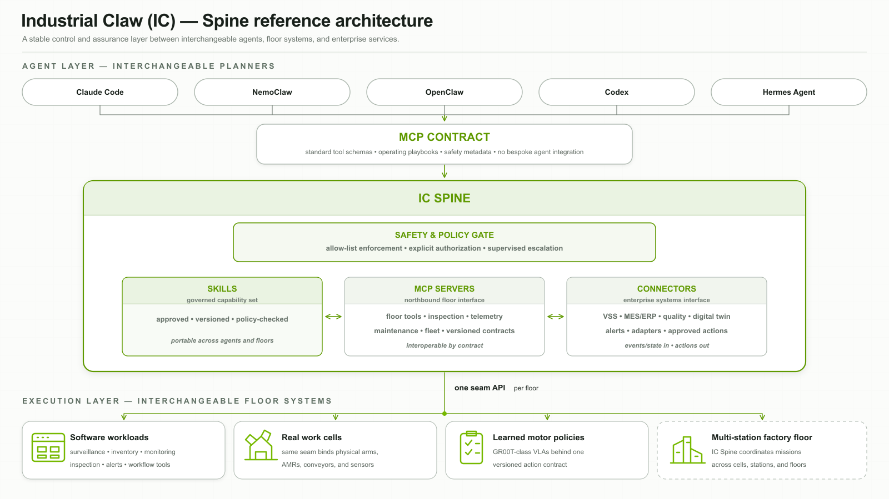
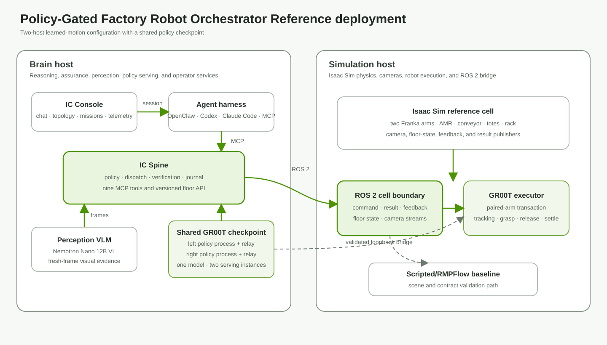

# Industrial Claw

<p align="center">
  <strong>Goal-driven, closed-loop orchestration for industrial robots, AGVs/AMRs, and conveyors.</strong>
</p>

<p align="center">
  <a href="LICENSE"></a>
  
  
</p>

---

**Industrial Claw** is the brain of the factory floor. An operator gives it a goal in plain
language — *"tidy the conveyor and shelve the tote"* — and it perceives the floor **by camera**,
plans the work, dispatches policy-gated robot actions — including coordinated two-arm pairs —
**verifies every step against physics and cameras**, and retries or escalates when reality
diverges from the plan.

**The IC Spine is a stable control and assurance layer between interchangeable agents,
floor systems, and enterprise services.** The same live Isaac Sim cell has run the same mission
under OpenClaw, and under Claude Code over MCP — swap the agent, keep the guarantees. Safety
policy, verification, the operating playbook, and the audit journal live in the Spine, not in
any harness.

Industrial Claw has two primary software components:

- **[IC Spine](ic-spine/)** — the policy-gated orchestration, perception,
  dispatch, verification, and audit service.
- **[IC Console](ic-console/)** — the operator interface for topology, chat,
  inspection, missions, and system telemetry.

The complete Isaac Sim and GR00T implementation is organized as the
**[Industrial Claw reference implementation](reference/industrial-claw/)**.

## Architecture



**Reference deployment topology** (hosts, interfaces, packages, and protocols):



Repository map: [`STRUCTURE.md`](STRUCTURE.md).

Deployment guide: [`docs/REPRODUCIBLE-DEMO.md`](docs/REPRODUCIBLE-DEMO.md) ·
validated platforms: [`docs/SUPPORT.md`](docs/SUPPORT.md) · endpoint
integration: [`docs/ENDPOINT-INTEGRATION.md`](docs/ENDPOINT-INTEGRATION.md).

## The demo

The primary demo is an **Isaac Sim warehouse cell** — two Frankas, an AMR,
red cubes, blue cylinders, green bricks, two totes, and a rack — driven end-to-end by natural language,
vision-only perception (Nemotron Nano 12B VL, fresh-frame guaranteed), every action physics-verified,
every operation journaled with the camera frame the VLM saw.

https://github.com/user-attachments/assets/9f15f687-9a6d-4669-ac43-73ba49f89427

*one natural-language goal → sort → haul → verified — ([full video file](docs/IC_Demo.mp4))*

The learned-motion path uses **one fine-tuned GR00T checkpoint served by two
policy processes**, one for each arm. Both processes load the same model. The
arms execute one mixed-color pair concurrently, verify both placements, then
advance to the next pair. Internal ports, hashes, and executor lineage live in
the technical bundle rather than this overview:
[`reference/industrial-claw/groot/`](reference/industrial-claw/groot/).

The control-plane quick start has three stages: **bring up the body → bring up the Spine →
connect an agent**, then operate. For the complete learned-motion setup — pinned model,
two serving instances, relays, two-host bridge, and cell contracts — follow the
[`reproducible GR00T deployment guide`](docs/REPRODUCIBLE-DEMO.md).

### 1. The body — Isaac Sim cell (GPU box)

The Isaac Sim cell is packaged as
[`reference/industrial-claw/isaac-cell/ic_cell`](reference/industrial-claw/isaac-cell/)
with a defined initialization interface:

```bash
# one-time: copy ic_cell/ + ic_boot.py into the container's mounted scripts dir
cp -r reference/industrial-claw/isaac-cell/ic_cell reference/industrial-claw/isaac-cell/ic_boot.py \
      <isaac-mount>/   # e.g. ~/docker/isaac-sim/documents/
```

Start Isaac Sim, then in **Window → Script Editor** run once:

```python
exec(open("/scripts/ic_boot.py").read())
```

Markers stream to the container log, ending `IC_CELL_UP`: stage, robots, cameras (hand-tuned
poses), ROS 2 publishers, and a deterministic demo start. Re-running is safe (forces a clean
stage reload).

### 2. The Spine — floor service (brain host, e.g. Jetson Thor)

```bash
cd ic-spine
python3.12 -m venv --system-site-packages .venv    # system-site: sourced ROS rclpy
.venv/bin/pip install -e ".[dev]"

export IC_FLOOR_BACKEND=ros2 ROS_DOMAIN_ID=0
export IC_FLOOR_SCENE=$PWD/configs/scene.our_demo.yaml
export IC_VLM_URL=http://127.0.0.1:8001            # local OpenAI-compatible VLM
export IC_VLM_MODEL=nvidia/NVIDIA-Nemotron-Nano-12B-v2-VL-NVFP4-QAD
export IC_PERCEIVE_MODE=vision_only                # the agent works by sight
export IC_JOURNAL_DIR=~/ic-journal                 # mission journal + evidence frames
.venv/bin/industrial_claw serve --port 8766        # or the systemd unit pattern in ops/
```

Validate the deployment before running a mission:

```bash
curl -s http://127.0.0.1:8766/v1/health             # ROS context + signal freshness
.venv/bin/pip install -e ../packages/conformance-kit
.venv/bin/ic-conformance run --target http://127.0.0.1:8766   # must print CERTIFIED 9/9
```

`GET /docs` serves the full OpenAPI contract; the pinned copies live in
[`schemas/`](schemas/) next to the cell-protocol schemas.

### 3. The brains — connect any harness

Every MCP-capable harness gets the same handshake: **9 annotated floor tools + the operating
playbook** ([`skills/industrial-claw-orchestrator/PLAYBOOK.md`](skills/industrial-claw-orchestrator/PLAYBOOK.md))
shipped as server `instructions`. No profile setup, no prompt copying.

Once, on the brain host:

```bash
cd servers/industrial-claw-mcp && python3 -m venv .venv && .venv/bin/pip install -e .
```

**Claude Code** — any machine with SSH reach to the brain host:

```bash
claude mcp add --scope user ic-floor -- ssh <user>@<brain-host> '<repo-root>/servers/industrial-claw-mcp/.venv/bin/ic-mcp'
# verify: /mcp shows ic-floor connected with 9 tools
```

**Codex CLI** — add to `~/.codex/config.toml`:

```toml
[mcp_servers.ic-floor]
command = "ssh"
args = ["<user>@<brain-host>", "<repo-root>/servers/industrial-claw-mcp/.venv/bin/ic-mcp"]
```

**Hermes / NIM agents / Claude Desktop / anything MCP** — register the same stdio command in
the harness's MCP config. If it speaks MCP, it can drive the floor; the doctrine arrives in
the handshake.

**OpenClaw** — dashboard/chat harness using the same governed MCP server:

```bash
npm ci && npm test             # pinned runtime + plugin vitest suite
ops/gw.sh --bind loopback      # gateway :18790, state in ~/.industrial-claw/openclaw
# after first start, in a second terminal:
ops/sync-playbook.sh           # inject the playbook into the active profile
# dashboard: SSH tunnel -> http://127.0.0.1:18790/#token=<gateway.auth.token>
```

### 4. Operate

Run the demo with this goal:

> **Reset and inspect the simulated cell. Pick left blue and right green
> together, then left green and right red together, then left red and right
> blue together. Verify both totes after each pair. Finally, haul both totes to
> the rack and verify completion.**

Watch the cell: reset and perceive → execute three concurrent arm pairs →
verify both totes after every pair → haul the loaded totes → verify the rack.
Useful while it runs and after:

- **Progress** — `/ic/feedback` streams haul phases; every action carries a goal ID
  (duplicates dropped, results matched exactly).
- **Reset between runs** (operator-only under the policy gate):
  ```bash
  curl -s -X POST http://<brain-host>:8766/v1/dispatch -H "Content-Type: application/json" \
       -H "x-role: operator" \
       -d '{"action":"reset_scene","endpoint":"mobilebot","scene_profile":"groot_three_object","arm":"both","color":"red","layout_left":3,"layout_right":3,"seed":31302}'
  ```
  — or just ask the MCP session to call `reset_scene`.
- **Cancel a running task** — dispatch `{"action":"cancel", ...}` the same way; it preempts
  cleanly, without queuing behind the task it stops.
- **Audit** — `$IC_JOURNAL_DIR/journal.jsonl` + `frames/`: every operation with its result,
  duration, mission ID, and the exact image the VLM saw.

## Status

| Capability |
|---|
| **MCP server** ([`servers/industrial-claw-mcp`](servers/industrial-claw-mcp/)) — 9 annotated floor tools, with the playbook distributed as `instructions`; validated using the reference mission and conformance suite |
| **Floor API** — versioned `/v1`, validated requests, request IDs, `_meta` freshness on every response, `GET /v1/health` (degraded-aware), self-documenting `/docs`, systemd-managed |
| **Cell as a package** ([`ic_cell`](reference/industrial-claw/isaac-cell/)) — defined initialization interface and owned runtime state |
| **Action protocol** — goal IDs (exact result matching), duplicate-drop, `/ic/feedback` progress stream, mid-flight `cancel` |
| **Policy gate at the seam** — unknown actions refused, required params enforced, operator-only class (`x-role`) — one gate for every harness |
| **Pinned contracts** ([`schemas/`](schemas/)) — OpenAPI (drift-guarded by test) + the cell protocol |
| **Conformance kit** ([`packages/conformance-kit`](packages/conformance-kit/)) — `run` seam 9/9 · `mcp` server 6/6 · `skill` manifest 7/7, with all reference checks passing |
| **Vision-only perception** — camera + Nemotron Nano 12B VL with a fresh-frame guarantee; dispatch stays physics-verified |
| **One-model concurrent GR00T path** — one shared checkpoint, two per-arm serving processes, and three verified concurrent pairs |
| **Mission journal** — every floor op + the exact VLM input frame, mission-grouped (`IC_JOURNAL_DIR`) |
| **Audit store (SQLite)** — derived from the journal, 30-day retention; queryable via `GET /v1/missions` and the `mission_history` / `mission_detail` MCP tools |
| **Creation workflows** — [`servers/TEMPLATE`](servers/TEMPLATE/) · [`connectors/TEMPLATE`](connectors/TEMPLATE/) + [`connector-sdk`](packages/connector-sdk/) · [`skills/TEMPLATE`](skills/TEMPLATE/) with catalogs |
| **Canonical playbook** ([`skills/industrial-claw-orchestrator`](skills/industrial-claw-orchestrator/)) — synchronized with deployment profiles, distributed over MCP, and validated against its manifest |
| **Hardware-free tests** — unit, protocol, runtime, relay, bridge, and MCP contract suites run without Isaac Sim or robot hardware |
| **NeMo Gym environment** ([`connectors/nemo-gym`](connectors/nemo-gym/)) — benchmark any model/agent on the cell with physics-verified rewards; rollouts export to NeMo RL / VeRL |
| **Live console** ([`ic-console`](ic-console/)) — read-only system topology with measured statuses + mission replay at `:8600` |
| **Workflow builder** ([`servers/ic-workflows`](servers/ic-workflows/)) — compose MCP tool verbs into gated, journaled workflows from the console UI; publish as conformant skills |
| **Chat gateway** ([`servers/ic-chat`](servers/ic-chat/)) — chat with a swappable OpenAI-compatible model endpoint that drives the cell through the gated, journaled tool loop |
| **NL authoring assistant** ([`servers/ic-workflows`](servers/ic-workflows/) `/api/assist`) — drafts workflows and skills from natural language; outputs are schema-validated before publication |

**Integrating your system or team?** Start from the matching template, then run
`ic-conformance` to validate the integration:
[`servers/TEMPLATE`](servers/TEMPLATE/README.md) (expose tools) ·
[`connectors/TEMPLATE`](connectors/TEMPLATE/README.md) (wrap MES/VSS/QC systems) ·
[`skills/TEMPLATE`](skills/TEMPLATE/SKILL.md) (ship know-how).

## Hardware targets

| Host | Role | Hardware |
|---|---|---|
| **Brain host** | floor service, MCP server, harness, local Nemotron perception VLM | NVIDIA Jetson AGX Thor (ARM64, Blackwell, ~128 GB unified) |
| **Sim host** | Isaac Sim cell, ROS 2 bridge | Linux PC with NVIDIA RTX GPU |
| **Operator host** | Claude Code / Codex / dashboard | anything with SSH or a browser |

## License

Industrial Claw is licensed under the [Apache License 2.0](LICENSE).
See [`NOTICE`](NOTICE) and [`THIRD-PARTY-NOTICES.md`](THIRD-PARTY-NOTICES.md)
for copyright and third-party attribution information.
