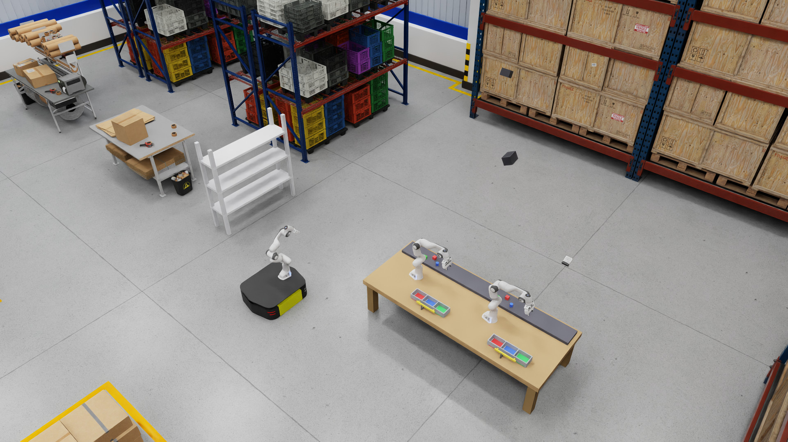
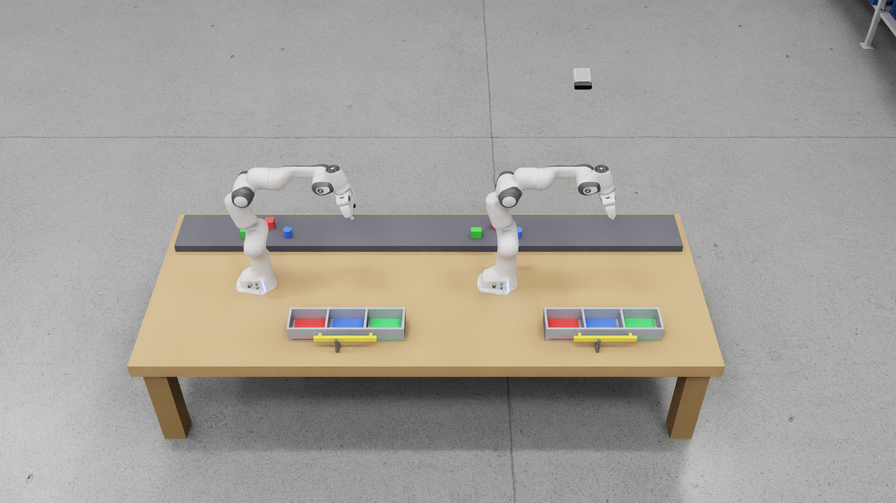
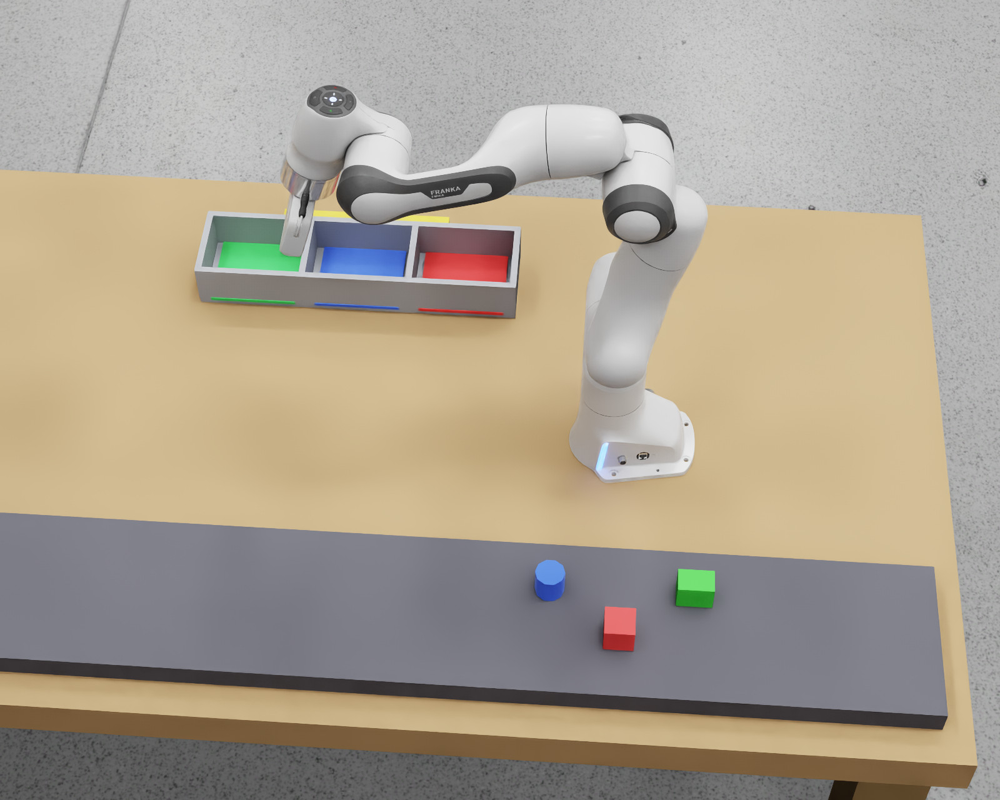
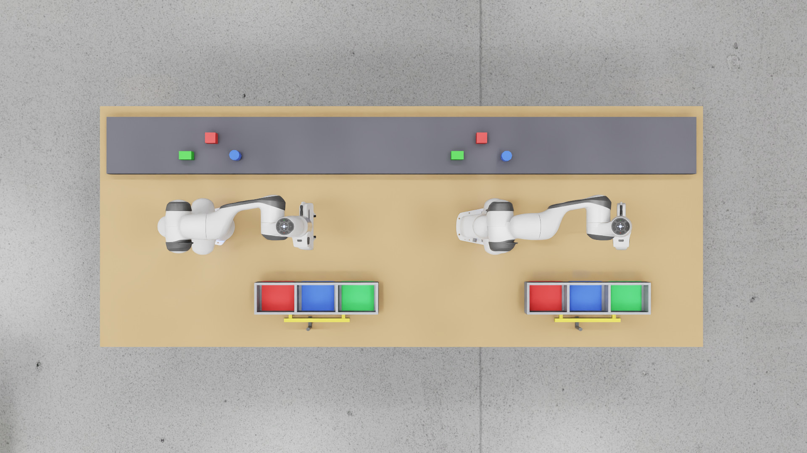

# Isaac Sim scene guide

These pictures were captured from the reference cell running in Isaac Sim.
They show the sorting stations, objects, totes, and transport equipment.

## Cell overview

| Component | Where to look | What it does |
|---|---|---|
| Sorting stations | Wooden table on the right | Two fixed Franka arms pick objects from the shared conveyor area. |
| Totes | Two narrow, divided bins at the front of the table | Receive the sorted objects and travel to the rack. |
| Mobile manipulator (AMR) | Black-and-yellow platform with a third arm, left of the table | Picks up and transports the totes. |
| Rack 1 | Light-gray, freestanding shelf behind the AMR | Receives both totes on its lowest shelf. |
| Warehouse background | Tall blue shelving, crates, and packing tables | Provides the surrounding environment; these are not the tote delivery target. |

## Left and right sorting stations

Each fixed Franka arm sorts its own group of objects into its own tote, one
object at a time.

The dark **conveyor area** behind the arms is a stationary staging surface in
this layout. The arms can use scripted control or a user-trained GR00T policy;
see [deployment profiles](../INSTALL.md).

## Left arm close-up

Viewed from the conveyor side, the left arm sits between its loose objects
and the divided tote.

## Objects and tote compartments

Each arm has the same three objects to sort:

| Object | Shape | Destination in its tote |
|---|---|---|
| Red object | Cube | Red compartment |
| Blue object | Cylinder | Blue compartment |
| Green object | Rectangular brick | Green compartment |

Physical dividers separate the tote compartments. Colored floor pads mark
the destinations; the loose objects start on the conveyor. The dark grasp pin
at the front of each tote is the AMR pickup target.

## Mobile manipulator

A third Franka arm rides on the **AMR's wheeled base**. Its scripted controller
picks up each tote, carries it to Rack 1, and releases it on the shelf. A
temporary Isaac Sim physics joint secures the tote to the gripper during
transport. This controller does not use GR00T.

## Rack 1

The light-gray rack receives both totes **side-by-side on its lowest shelf**.

## Cameras

| View | Purpose |
|---|---|
| Outside views of the left and right stations | Show objects and the surrounding work area for learned arm control. |
| Wrist cameras on both sorting arms | Show the gripper and nearby objects during manipulation. |
| Table view | Observes both sorting stations and totes. |
| Inspection and rack views | Supply scene evidence for perception and outcome verification. |

These pictures use a separate viewing camera. GR00T and the VLM receive images
from the cameras listed above, with their configured crops.

For setup, see [Installation](../INSTALL.md). For service and model connections,
see [Architecture](ARCHITECTURE.md). To adapt the scene, start with
[the reference cell source](../reference/isaac-cell/).
